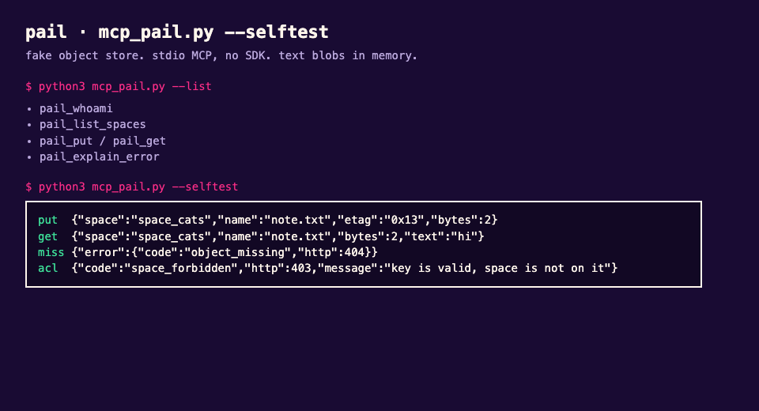
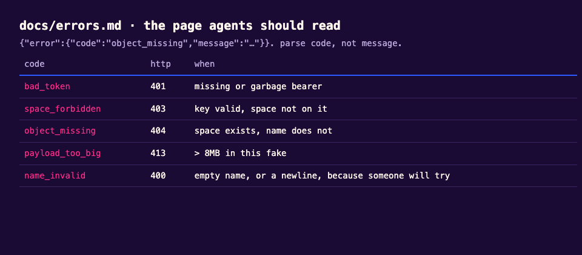

# docs-the-agent-can-read

Most API docs are written for a person with a browser. In 2026 half the "developers" hitting your product are models fetching `llms.txt` at 3am.

This is a fake object store called **pail**. The interesting bit is not the store. It is:

- `llms.txt` that points at the pages that actually matter
- OpenAPI that matches the prose (I have been burned by this)
- a tiny MCP server so an agent can list spaces / put a blob / decode an error without scraping the marketing site
- a quickstart a human can finish in one coffee

I used to write this kind of thing for a real storage product. That docs site is not mine to republish. Pail is the drill.

## files

| | |
| --- | --- |
| `llms.txt` | what you want a crawler or a model to open first |
| `openapi.yaml` | the contract |
| `docs/quickstart.md` | human path |
| `docs/errors.md` | the page agents should read and humans skip |
| `mcp_pail.py` | stdio MCP, no SDK, ~200 lines |

## run the mcp thing

```bash
python3 mcp_pail.py
```

It speaks JSON-RPC on stdin/stdout. If you just want to see the tools:

```bash
python3 mcp_pail.py --list
```

There is no hosted pail. The server keeps two spaces in memory and pretends you uploaded a cat.





## opinion

If your docs need a chrome extension to be useful, the page is wrong. If your MCP tool is `search_docs` wrapping the blog, the tool is wrong. Put the error codes in a file and let both humans and models read the same file.
